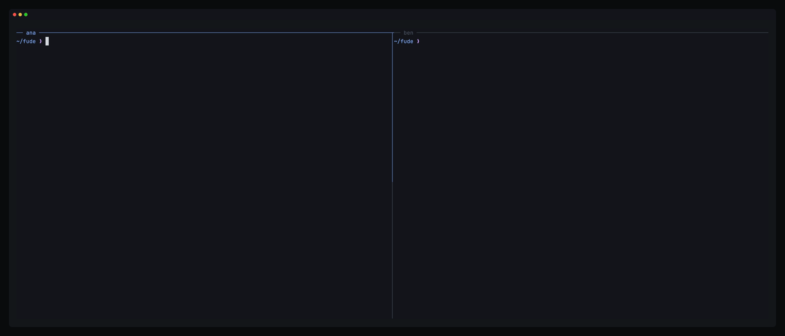

<div align="center">

# fude

**Vim's grammar, with everything built in.**

A modal editor for the terminal, built from Go libraries you can use on their own.

[](LICENSE)
[](#status)
[](https://github.com/sponsors/y3owk1n)

macOS | Linux | Windows

[Install](#install) | [Tour](#first-steps) | [Built in](#built-in) | [Together](#edit-together) | [Plugins](#plugins) | [Libraries](#build-on-fude) | [Speed](#speed)

</div>

---


fude (筆) is a writing brush. It is an editor for people who already think in Vim, and a set of Go modules for people who build editors.

## Why fude

- **Your Vim keys, exactly.** `ciw`, `dap`, `.`, macros, registers and `:s` do what they do in Neovim.
- **Everything built in.** Language servers, tree-sitter, a finder, git, a debugger and live sharing, with no plugins to wire up.
- **One TOML file.** Settings and keymaps are data. Nothing in your config runs.
- **Plugins can't freeze you.** They run as sandboxed WebAssembly with a time limit on every call.
- **Nothing is lost.** Every edit lands on a branching timeline on disk, so a crash loses nothing and undo never drops a branch.
- **Fast, and tested to stay fast.** A key draws in under 1ms at p99 on 10MB of Go, and a test fails when it doesn't.
- **A library too.** The kernel, the Vim grammar, the syntax and the LSP and DAP clients are Go modules you can import.

## Install

```sh
oku add github:y3owk1n/fude     # with oku, man pages included
go install github.com/y3owk1n/fude/cmd/fude@latest
```

Each [release](https://github.com/y3owk1n/fude/releases) also has zips for macOS, Linux and Windows on arm64 and amd64. On macOS and Linux, fude builds grammars with the `tree-sitter` CLI.

On macOS, `fude --gui` opens fude in a native window, and oku also puts `Fude.app` in `~/Applications`. On Linux it opens a GTK 4 window, so it needs GTK 4, as `libgtk-4-1` on Debian and Ubuntu, and oku also adds Fude to the desktop's launcher. The macOS zips hold it too. `Fude.app` is unsigned for now, so a copy downloaded in a browser opens only after `xattr -dr com.apple.quarantine Fude.app`.

<details>
<summary>Building from source, and what fude uses when it is on PATH</summary>

Building needs Go 1.27 or later and a C compiler, since tree-sitter uses cgo. On Windows that is llvm-mingw's `gcc` and Git for Windows.

```sh
git clone https://github.com/y3owk1n/fude && cd fude
go build -o bin/fude ./cmd/fude
```

| Tool | For |
| :--- | :-- |
| `git` and `tree-sitter`, or `git` and `gcc` on Windows | Building grammars |
| `rg` | `:pick grep`, else `git grep` |
| `pbcopy`, `wl-copy` or `xclip` | The clipboard |
| TinyGo | Building plugins |
| A nerd font | Icons, off by default |

fude needs a terminal with true colour.

</details>

## First steps

```sh
fude main.go
```

- **Edit.** `daf` deletes the function you are in and `cia` changes an argument, in every language with a grammar.
- **Find.** `:pick files` and `:pick grep` search with a live preview.
- **Rewind.** `:timeline` lists every state of the file, diffs any of them and restores one.
- **Ask.** Type part of a command and pause, and key hints show what can follow. `:h guide-start` opens the guide.

## Built in

| Area | What you get |
| :--- | :----------- |
| **Editing** | Jump by label with `s`, edit every match with `<C-n>`, folds, surround, macros, `:s` with a live preview |
| **Timeline** | Branching undo, `:earlier 10m`, `:timeline` to diff and restore, `:recover` after a crash |
| **Syntax** | tree-sitter with 49 grammars built on first use, `daf` and `cia`, the enclosing function pinned on top |
| **Language servers** | Several per file, hover, references, code actions with a preview, inlay hints, completion |
| **Debugging** | DAP adapters, breakpoints, stepping and a panel of frames and variables |
| **Finder** | Files, grep, buffers, symbols, diagnostics and help, and `:pin` for files a key away |
| **Git** | Signs, hunk preview, stage with `gh`, `:gitdiff`, `:blame` |
| **Files** | Edit a folder as text, then `:w` to rename, create and delete |
| **Terminal and tasks** | `:terminal`, and `:task` for just recipes, make targets and npm scripts |
| **Look** | Dark and light themes, any base16 scheme, markdown drawn as it reads, images in kitty, Ghostty, WezTerm and iTerm2 |

## Where it drifts from Neovim

Neovim is the reference, and fude departs only where that is better. [`prd/decisions.md`](prd/decisions.md) gives each reason.

- **Gone.** fude has no vimscript, Lua, Ex mode, Select mode, modelines, swap files or mouse. The timeline does what swap and undo files did.
- **Config.** It is one TOML file, with fude's own option names such as `relative_number`. Plugins are sandboxed wasm.
- **Search.** fude runs Vim's patterns on a linear-time engine and refuses backreferences, so no pattern can hang the editor.
- **Defaults.** Space is the leader, splits open below and right, brackets close themselves, and indent guides and key hints are on.
- **Keys.** `s` jumps by label, `S` in visual mode surrounds, `<C-n>` adds a region, `=` formats as `gq` does, and `q` closes fude's own windows.
- **Built in.** `:pick` replaces `:grep` and picker plugins, folds come from indent, and language server keys exist only while a server is attached.
- **Restart.** `:restart` keeps unsaved changes, since the timeline holds them.

## Edit together



```sh
fude attach            # another session of the fude running here
fude share             # let someone in over TLS
fude join <string>     # on their machine
```

Everyone has their own cursor, colour, windows and undo. `:follow ana` keeps your view on what ana sees. A guest edits only the project, and `fude join --read-only` watches without editing. Agents attach the same way and propose edits you `:accept` or `:reject`.

## Configure

fude reads `~/.config/fude/config.toml`, and every key in it is optional.

```toml
theme = "dark"
relative_number = true

[keymap.normal]
"<Leader><Leader>" = ":pick files<CR>"

[filetype.go]
lsp = ["gopls"]
format = ["goimports", "gofumpt"]

[module.autopairs]
enabled = false
```

`:h settings` lists every key, and `:set` changes one while fude runs.

## Plugins

A plugin is Go built into WebAssembly with TinyGo. It gets only the capabilities its table grants.

```go
func init() {
	sdk.Operator("zu", "upper-cases what a motion covers", func(r sdk.Range) {
		text, err := sdk.Text(r.Start, r.End)
		if err != nil {
			sdk.Log(err.Error())
			return
		}
		sdk.Edit(r.Start, r.End, strings.ToUpper(text))
	})
}
```

```toml
[[plugin]]
path = "plugins/upper.wasm"
capabilities = ["buffer.read", "buffer.write"]
```

`zu` now works with every motion, count, macro and `.`. `fude plugin new upper` starts one, and `:h guide-plugins` covers the rest.

## Build on fude

Every layer is a Go module with a small API, and the editor uses each one the way your program would.

| Module | What it is | Needs |
| :----- | :--------- | :---- |
| [`core`](core) | A text buffer with marks and a branching timeline, on a persistent rope | The standard library |
| [`vim`](vim) | Vim's grammar as a state machine over your own text and host | Two Unicode packages |
| [`syntax`](syntax) | tree-sitter highlighting and syntax text objects | cgo |
| [`protocol`](protocol) | LSP and DAP clients that never block your loop | The standard library |
| [`api`](api), [`plugin`](plugin), [`sdk`](sdk) | The module API, the wasm plugin host and its Go SDK | wazero |
| [`editor`](editor), [`modules`](modules) | The whole editor headless, and its 44 built-in modules | fude's root module |

```sh
go get github.com/y3owk1n/fude/core github.com/y3owk1n/fude/vim
```

A distribution of your own is a list of modules handed to `editor.Use`. Each package's README shows how to start.

## Speed

Each line is a test, measured on an Apple M-series Mac, and `just check` fails when one regresses.

| Promise | Limit | Measured |
| :------ | :---: | :------: |
| Cold start to first frame | 5ms | 1 to 3ms |
| Key to frame, p99, 10MB of Go with syntax | 1ms | 0.75ms |
| The same with every module, git, a language server and a plugin | 2ms | 1ms |
| A scroll with everything the modules draw for it, p99 | 5ms | 1.3ms |
| Undo and redo on a 10,000-step timeline, p99 | 1ms | 0.3ms |
| A key after a burst of 10,000 edits, every module on, p99 | 1ms | 0.5ms |
| `:%s` over 10MB of Go | 50ms | 18ms |
| Through `fude attach`, p99 | 5ms | 0.8ms |
| First frame of a 1GB file | 1s | 0.55s |

Memory stays flat too. A hundred files opened, edited and closed, or sixty terminals run and ended, leave nothing behind.

## Status

fude is alpha. Releases are 0.x, and the config, plugin ABI, protocol and library APIs may change between them. Keep backups of work you care about.

## Documentation

| | |
| :- | :- |
| `:h guide-start` | The guide, from your first file on |
| `:h settings` | Every setting |
| `fude help` | Every command-line option |
| `fude man` | The man pages |
| [`prd/`](prd) | The spec: what fude promises, how it works and why |

## Contributing

```sh
oku sync && oku allow    # the toolchain from oku.toml
just check               # format, vet, tests with -race, and the promises
```

A change starts from the spec: a behaviour in [`prd/behaviours.md`](prd/behaviours.md), a test named after it, then the code. [`AGENTS.md`](AGENTS.md) holds the conventions.

## Credits

fude follows [Neovim](https://neovim.io) and [Vim](https://www.vim.org) for how an editor behaves.

<details>
<summary>Built on, and following</summary>

fude is built on [tcell](https://github.com/gdamore/tcell), [wazero](https://github.com/tetratelabs/wazero), [tree-sitter](https://tree-sitter.github.io) and its [Go binding](https://github.com/tree-sitter/go-tree-sitter) with every grammar's authors, [go-toml](https://github.com/pelletier/go-toml), [uax29](https://github.com/clipperhouse/uax29), [displaywidth](https://github.com/clipperhouse/displaywidth), [charmbracelet/x/vt](https://github.com/charmbracelet/x), [go-colorful](https://github.com/lucasb-eyer/go-colorful), [go-pointer](https://github.com/mattn/go-pointer), Go's [x](https://pkg.go.dev/golang.org/x) packages, [TinyGo](https://tinygo.org) and [Binaryen](https://github.com/WebAssembly/binaryen).

Much of it follows a project that did it first: [oil.nvim](https://github.com/stevearc/oil.nvim), [fff.nvim](https://github.com/dmtrKovalenko/fff), [which-key.nvim](https://github.com/folke/which-key.nvim), [gitsigns.nvim](https://github.com/lewis6991/gitsigns.nvim), [mini.diff](https://github.com/nvim-mini/mini.diff), [mini.icons](https://github.com/nvim-mini/mini.icons), [conform.nvim](https://github.com/stevearc/conform.nvim), [undo-glow.nvim](https://github.com/y3owk1n/undo-glow.nvim), [nvim-tmux-navigation](https://github.com/alexghergh/nvim-tmux-navigation), [fzy](https://github.com/jhawthorn/fzy), [CodeMirror's collab module](https://codemirror.net/examples/collab/), [base16](https://github.com/chriskempson/base16), [Tinted Theming](https://github.com/tinted-theming), [stylix](https://github.com/nix-community/stylix), [Helix](https://helix-editor.com) and [Zed](https://zed.dev). `:pick grep` runs [ripgrep](https://github.com/BurntSushi/ripgrep), and [just](https://github.com/casey/just) and [oku](https://github.com/y3owk1n/oku) run fude's development.

</details>

## Support

One person builds fude in their spare time. If you use it, you can [sponsor it](https://github.com/sponsors/y3owk1n). Also by the same author: [neru](https://github.com/y3owk1n/neru) and [mimi](https://github.com/y3owk1n/mimi).

## License

MIT. See [LICENSE](LICENSE).
