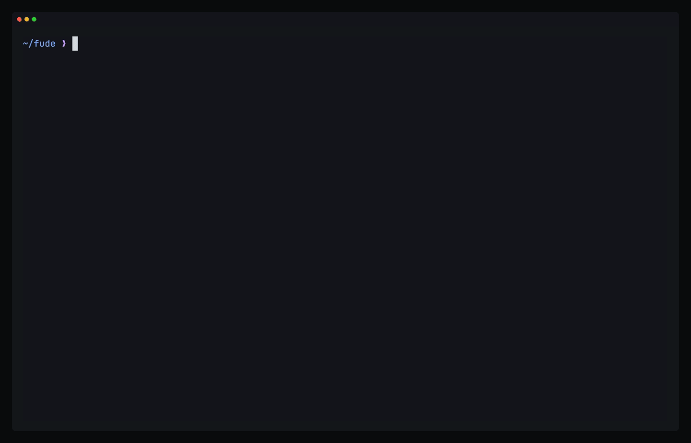

<div align="center">

# fude

A modal text editor with Vim's grammar, rebuilt from the kernel up. Language servers, tree-sitter, a finder and git come built in, and one TOML file sets them all.

[](LICENSE)
[](#status)
[](https://github.com/sponsors/y3owk1n)

|     macOS      |          Linux          |     Windows     |
| :------------: | :---------------------: | :-------------: |
| Daily driver   | Builds, less tested     | Not supported   |

[Why](#why-fude-exists) · [Principles](#what-fude-believes) · [Install](#install) · [Tour](#a-first-session) · [Built in](#whats-built-in) · [How it works](#how-it-works) · [Compare](#how-fude-compares)

</div>

---



fude (筆) is a writing brush. It is a terminal editor for people who already know Vim's keys. `ciw`, `dap`, `3j`, `.`, `q`, `"a`, `:s` and `<C-w>v` do what they do in Neovim. Underneath, everything is new: a small kernel with a branching history on disk, a vim machine that every edit goes through, plugins in a sandbox, and an editor that runs headless with the terminal as one of its clients.

## Why fude exists

Neovim is the editor whose behaviour fude copies, and it carries three costs.

- **Thirty years of compatibility.** Vimscript, Ex mode, Select mode, modelines, swap files and hundreds of option names stay so that old scripts keep working.
- **Plugins run inside the editor.** A Lua plugin runs on the same thread as your typing. One slow autocommand or a loop in a status line plugin freezes every keystroke, and finding which plugin did it takes a profiler.
- **A config that never stops growing.** Language servers, completion, a finder, git signs, formatting and key hints each come from a plugin you choose, wire up and keep updated. The config is code, and it runs on every event.

Helix and Kakoune are lean because they started over, and they changed the grammar too, so you select first and act second. A Vim user has to relearn every edit. fude keeps Vim's grammar exactly and rebuilds everything under it.

## What fude believes

**Neovim is the reference.** Where fude's spec says nothing, a key does what it does in Neovim. fude departs only where the departure is better, and each of its 30 departures is written down with its reason in [`prd/decisions.md`](prd/decisions.md).

**Configuration is data.** `config.toml` holds settings, keymaps and per-language tables. A keymap maps keys to keys, an ex line or a plugin's function. Nothing in the config runs later, because a config that registers callbacks is a plugin without a sandbox or a time limit, and that is the problem fude exists to avoid.

**Extensions run in a sandbox.** A plugin is WebAssembly, run by [wazero](https://github.com/tetratelabs/wazero), with the capabilities its config table grants and a time budget on every call. fude stops and unloads a plugin that loops forever, and you keep typing. fude's own operators, text objects, commands and status line use the same API a plugin gets, so a plugin can do anything the editor does. A plugin that adds a `gs` sort operator gets `gsip`, `gsaf` and `gs3j` with no more code.

**Every edit goes through one grammar.** A typed key, a macro, a plugin's key and a remote client's command all become keys the vim machine runs. That is why `.` repeats a plugin's edit, a macro can hold `:w`, and a client's edit undoes like a typed one.

**Nothing you typed is lost.** Text lives in a persistent rope, so every edit is a cheap snapshot on a branching timeline. Undo never throws a branch away, `:timeline` diffs any two states, and `:earlier 10m` goes back by time. fude appends the timeline to disk as you type, which replaces both swap files and undo files. A crash loses no edit, `:recover` brings back what was unsaved, and closing a file keeps the newest megabyte of its history for next time.

**The editor is a server.** The editor runs without a terminal. The terminal is one client, other programs attach over a socket, and the tests drive it with no terminal at all. A client can send an edit as a proposal, which shows as ghost text and changes nothing until you `:accept` it. That is how an AI agent should edit your code. It never moves your cursor, its change follows your edits, and accepting it is one step you can undo.

**Speed is tested.** Each speed promise below is a test, and `just check` fails when one regresses. Nothing on the input path waits for a language server, a grammar build or a plugin.

**Standards before inventions.** Language servers speak LSP, highlighting uses each tree-sitter grammar's own queries, snippets are VS Code's snippet files, and themes are base16 schemes. So the language servers, grammars, snippet files and themes that exist today work in fude.

## Who fude is for

fude fits if you think in Vim's grammar, want language servers, a finder and git without assembling them from plugins, and want one config file with no code in it.

It does not fit if you depend on Neovim's Lua plugins, which fude will never run, or need a mouse, a GUI, a debugger or folding, which fude does not have. See [Status](#status) before you trust it with work.

---

## Install

With [oku](https://github.com/y3owk1n/oku), one line builds the newest commit of `main` and installs fude with its man pages:

```sh
oku add github:y3owk1n/fude
```

`oku update fude` moves to the newest commit.

<details>
<summary>From source</summary>

Needs Go 1.26 or later and a C compiler, as fude's tree-sitter binding uses cgo.

```sh
git clone https://github.com/y3owk1n/fude
cd fude
go build -o bin/fude ./cmd/fude
```

Put `bin/fude` on your PATH. `go install` works from the first release on. Until then the repository's modules point at each other through local paths, which `go install` refuses.

</details>

<details>
<summary>What fude uses when it is on PATH</summary>

| Tool                                        | For                                                  |
| :------------------------------------------ | :--------------------------------------------------- |
| `git` and the `tree-sitter` CLI             | Building grammars for languages other than Go        |
| `rg`                                        | `:pick grep`, which falls back to `git grep`         |
| `pbcopy`, `wl-copy` or `xclip`              | The system clipboard                                 |
| TinyGo                                      | Building plugins                                     |
| A nerd font                                 | Icons, which are off by default                      |

fude needs a terminal with true colour.

</details>

## A first session

```sh
fude main.go
```

The first frame shows in under 5ms, with no config file and nothing asking for one.

- **Edit as you always have.** `ciw`, `dap`, `3j`, `.` and `u` do what you expect. With the cursor in a function, `daf` deletes it and `cia` changes the argument under the cursor, in every language fude has a grammar for.
- **Find things.** `:pick files` opens a fuzzy finder and `:pick grep` a live grep, each with a preview. `:pick buffers` and `:pick recent` find open and recent files. `<C-q>` sends the matches to a list.
- **Go back in time.** After twenty minutes of refactoring, `:timeline` lists every state of the file. `[` and `]` scrub through them, `d` diffs one against now, and `<CR>` restores it as a new state, so even the restore can be undone.
- **Ask.** Type the start of a command and wait, and a panel shows every key that may follow. `:h guide-start` opens the written guide.

A file in a language other than Go builds its grammar in the background the first time you open it, and its colours appear when the build ends. `fude --tail` in another terminal prints what a running fude does, as it happens.

---

## What's built in

| Area                 | What you get                                                                                                       |
| :------------------- | :----------------------------------------------------------------------------------------------------------------- |
| **Editing**          | `s` to jump anywhere in view by a label, `ys`, `ds` and `cs` to surround, counts on both sides of an operator, registers and the clipboard, macros as editable text, `:s` with a live preview, `:g`, `:normal` |
| **Timeline**         | `u` and `<C-r>` along a branch, `g-` and `g+` across every state, `:earlier 10m`, `:timeline` to diff and restore, `:recover` after a crash |
| **Syntax**           | tree-sitter for Go built in, 46 more languages built on first use, code inside markdown coloured, `daf`, `cic` and `dia`, the enclosing function pinned at the top |
| **Language servers** | Several per file, merged diagnostics, hover, definitions, references, code actions, signature help, inlay hints, a `:lsp` panel |
| **Completion**       | From language servers, snippets, paths and the buffer, with VS Code snippet files                                  |
| **Formatting**       | Formatters by name, run in turn or the first that applies, with the language server as the fallback              |
| **Finder**           | `:pick` for files, grep, buffers, recent files, diagnostics, symbols, help and keymaps, with a preview, `<C-g>` to search ignored files, `<C-q>` to a list                           |
| **Folders**          | Edit a listing and `:w` to rename, delete and create files                                                         |
| **Git**              | Signs, `]h` and `[h` between hunks, a hunk preview, `gH` to put a hunk back as the index has it, `:blame` for the cursor's line                  |
| **Terminal**         | `:terminal` in a split, and `<Esc><Esc>` to move through its output in normal mode                                |
| **Discovery**        | Key hints for a half-typed command, `:h` with a written guide and a full reference, man pages                    |
| **Typing**           | Autopairs, and `#hex`, `rgb()` and `hsl()` text shown on the colour it names                                       |
| **Sessions**         | `:restart` reloads config and plugins and keeps every window, cursor and unsaved change                          |
| **Look**             | Dark and light themes in true colour, any base16 scheme such as stylix's `palette.json`, `:center` for prose      |

### Where it differs from Neovim

A few of the 30 departures, each with its reason in [`prd/decisions.md`](prd/decisions.md):

- **No vimscript, no Lua, no Ex mode, no Select mode, no modelines and no swap files.** The timeline does what swap files did, and more.
- **Search uses Vim's pattern syntax on Go's linear-time engine.** No pattern can hang the editor on a large file. fude refuses the few atoms that need backtracking, such as backreferences in a pattern, with a message naming them.
- **Options have fude's own names,** such as `relative_number` and `scroll_off`, since there are no old scripts to keep working.
- **Splits open below and right, and the leader is space,** as most Neovim configs set them.
- **`:restart` keeps unsaved changes** instead of refusing, because the timeline already holds them.
- **No mouse.** fude is for the keyboard.

---

## Configuration

fude reads `~/.config/fude/config.toml`, or `$XDG_CONFIG_HOME/fude/config.toml`. Every setting is optional, fude never writes the file, and `:restart` loads a change.

```toml
theme = "dark"
relative_number = true
scroll_off = 8
format_on_save = true

[keymap.normal]
"<Leader><Leader>" = ":pick files<CR>"
"<Leader>sg" = ":pick grep<CR>"

[keymap.groups]
"<Leader>s" = "search"           # the name key hints show

[filetype.go]
lsp = ["gopls"]
format = ["goimports", "gofumpt"]

[lsp.gopls]
root = ["go.work", "go.mod", ".git"]
```

`:h settings` explains every setting. `:h guide-config`, `:h guide-lsp` and `:h guide-format` walk through config, language servers and formatters.

## Plugins

You write a plugin in Go with fude's `sdk` and build it into a `.wasm` file with TinyGo. There is no plugin manager. A plugin is a file and a table in `config.toml`.

```sh
fude plugin new upper && cd upper && fude plugin build
```

```go
func init() {
	sdk.Operator("zu", "upper-cases the text a motion covers", func(r sdk.Range) {
		text, err := sdk.Text(r.Start, r.End)
		if err != nil {
			sdk.Log(err.Error())
			return
		}
		sdk.Edit(r.Start, r.End, strings.ToUpper(text))
	})
}
```

```toml
[[plugin]]
path = "plugins/upper.wasm"
capabilities = ["buffer.read", "buffer.write"]
```

`zu` now works with every motion and text object, with counts, in macros and with `.`. A plugin gets only the capabilities its table names: `buffer.read`, `buffer.write`, `ui`, `fs.read`, `process` and `net`, the last two limited to the programs and hosts listed. fude logs a call outside them and returns an error to the plugin. `plugin/testdata` holds small examples, and `:h guide-plugins` covers the rest.

---

## How it works

```
clients   terminal | socket clients | agents
            | keys, commands             ^ state, edits
editor    one loop: config, windows, LSP, syntax, plugins (wasm), git
            | keys --> vim machine --> edits             (vim/, embeddable)
            | transactions               ^ changes
kernel    buffers | marks | transactions | timeline      (core/, embeddable)
storage   persistent rope with structural sharing
```

- **One goroutine owns every change.** Keys, the vim machine and edits run on one loop with no locks. Language servers, grammar builds and the finder work on snapshots of the text, which the persistent rope makes free, and post their results back. That is why nothing on the input path waits.
- **The vim machine never sees the kernel.** It reads text through a small interface and returns edits. The editor applies them as transactions, which carry their origin, so each client's `u` undoes only its own edits.
- **The kernel is mechanism only.** `core/` has no goroutines, no I/O and no dependencies, and `just check` fails if it grows past 10k lines. The editor gives it a store, and the store appends each change to the timeline log on disk.
- **Syntax comes from the grammars' own repos.** Go's grammar is linked in. fude builds any other on first use at a pinned commit, with the queries its repo ships, and `:grammar update` rebuilds the ones built at an older pin.
- **The spec comes first.** [`prd/`](prd) holds what fude is for, how it works, why it is shaped this way, and every behaviour it promises, each numbered and each with a test.

`core/` imports only the standard library, `vim/` never imports `core/`, and cgo lives only in the syntax package.

## Build on fude

**Clients and agents.** fude listens on a unix socket. A client sees the buffers and sends keys, commands or proposals on the same timeline as the terminal. Two clients editing one buffer converge to the same text. Go programs attach through the [`client`](client) package, and `:h guide-remote` has the protocol.

**The kernel and the grammar.** `core/` and `vim/` are Go modules of their own. Use the kernel for a text buffer with a branching history, or the vim machine for Vim's grammar over your own text, such as a text field in a TUI or a REPL.

```sh
go get github.com/y3owk1n/fude/core github.com/y3owk1n/fude/vim
```

<details>
<summary>A vim host over the kernel</summary>

A host embeds `vim.Defaults` for what it has no use for, such as jump lists, and writes the rest, about one line per method:

```go
type host struct {
	vim.Defaults
	b      *kernel.Buffer
	cursor kernel.MarkID
	marks  map[rune]kernel.MarkID
}

func (h *host) Text() vim.Text    { return h.b.Snapshot() }
func (h *host) Cursor() int       { return h.b.Mark(h.cursor) }
func (h *host) SetCursor(pos int) { h.b.MoveMark(h.cursor, pos) }
func (h *host) BeginGroup()       { h.b.BeginGroup("me") }
func (h *host) EndGroup()         { h.b.EndGroup("me") }

func (h *host) Apply(edits []vim.Edit, label string) error {
	t := kernel.Transaction{Base: h.b.Snapshot().Version(), Origin: "me", Label: label, Time: time.Now()}
	for _, e := range edits {
		t.Edits = append(t.Edits, kernel.Edit(e))
	}
	return h.b.Apply(t)
}

func (h *host) Undo() (int, int, error) {
	start, ok := h.b.Undo()
	if !ok {
		return 0, 0, vim.ErrNoStep
	}
	return start, start, nil
}
```

`Redo` has the shape of `Undo`. `SetMark` and `Mark` keep each name's `kernel.MarkID` in `marks`, and `Viewport` and `SetTop` come from the program's own view. `vim.New(&host{...})` then takes keys with `Feed`. The examples in each package's documentation run as tests.

</details>

---

## How fude compares

| Editor                            | Editing model               | Built in                                                            | Extended with                        | Configured with |
| :-------------------------------- | :-------------------------- | :------------------------------------------------------------------ | :----------------------------------- | :-------------- |
| **fude**                          | Vim's grammar               | LSP, tree-sitter, finder, grep, git hunks, folder editing, terminal | Sandboxed wasm with a time budget    | TOML            |
| [Neovim](https://neovim.io)       | Vim's grammar               | LSP client, tree-sitter, terminal                                   | Lua and vimscript, in process        | Lua             |
| [Helix](https://helix-editor.com) | Select first, as Kakoune    | LSP, tree-sitter, file and grep pickers                             | None in its releases yet             | TOML            |

## Performance

Measured on an Apple M-series Mac. `just check` fails when one of these regresses.

| Promise                                                                  | Limit | Measured     |
| :----------------------------------------------------------------------- | :---: | :----------: |
| Cold start to the first frame                                            | 5ms   | about 3ms    |
| A key read to its frame written, p99, on 10MB of real Go with syntax on  | 1ms   | about 0.75ms |
| The same in git and two windows, with a language server and a plugin     | 2ms   | about 0.9ms  |
| A 1GB file's first frame                                                 | 1s    | about 0.6s   |

## Status

fude is alpha. It has no releases or version numbers yet, and the config format, the plugin ABI, the socket protocol and the timeline log on disk may change between commits. Its author uses it daily on macOS. Keep backups of work you care about.

Not here yet: folding, debugging through DAP, and GPU or web clients. Never here: vimscript, Lua, the mouse, and plugins without a sandbox.

## Documentation

| Inside fude          |                                                    |
| :------------------- | :------------------------------------------------- |
| `:h guide-start`     | The written guide, from the first file onward      |
| `:h settings`        | Every setting in `config.toml`                     |
| `:h guide-plugins`   | Writing, building and loading a plugin             |
| `:h guide-remote`    | Attaching a client over the socket                 |
| `fude --man`         | fude(1), and with `config` or `guide`, fude-config(5) and fude-guide(7) |

## Contributing

[oku](https://github.com/y3owk1n/oku) installs the toolchain from `oku.toml`, and `just` runs the tasks.

```sh
oku sync && oku allow
just check    # formatting, vet, the tests with -race, the size and speed limits
just run      # build and open fude
```

A change starts from the spec: a behaviour in [`prd/behaviours.md`](prd/behaviours.md), a test named after it, then the code. [`AGENTS.md`](AGENTS.md) holds the conventions.

## Credits

fude follows [Neovim](https://neovim.io) and [Vim](https://www.vim.org) as its reference for how an editor behaves, and owes its grammar to them.

<details>
<summary>Built on, and following</summary>

fude is built on:

- [tcell](https://github.com/gdamore/tcell), for the terminal.
- [wazero](https://github.com/tetratelabs/wazero), which runs plugins with no cgo.
- [tree-sitter](https://tree-sitter.github.io) and its [Go binding](https://github.com/tree-sitter/go-tree-sitter), and the authors of every grammar and query fude builds.
- [go-toml](https://github.com/pelletier/go-toml), for `config.toml`.
- [uax29](https://github.com/clipperhouse/uax29) and [displaywidth](https://github.com/clipperhouse/displaywidth), for graphemes and their width.
- [charmbracelet/x/vt](https://github.com/charmbracelet/x), for `:terminal`.
- [go-colorful](https://github.com/lucasb-eyer/go-colorful), [go-pointer](https://github.com/mattn/go-pointer) and Go's [x](https://pkg.go.dev/golang.org/x) packages.
- [TinyGo](https://tinygo.org) and [Binaryen](https://github.com/WebAssembly/binaryen), which build plugins.

Much of what fude builds in follows a plugin or project that did it first: [oil.nvim](https://github.com/stevearc/oil.nvim) for editing folders, [fff.nvim](https://github.com/dmtrKovalenko/fff) for the finder and grep, [which-key.nvim](https://github.com/folke/which-key.nvim) for key hints, [gitsigns.nvim](https://github.com/lewis6991/gitsigns.nvim) and [mini.diff](https://github.com/nvim-mini/mini.diff) for git signs and hunks, [mini.icons](https://github.com/nvim-mini/mini.icons) for icons, [conform.nvim](https://github.com/stevearc/conform.nvim) for formatting, [undo-glow.nvim](https://github.com/y3owk1n/undo-glow.nvim) for the flash of a yank or undo, [nvim-tmux-navigation](https://github.com/alexghergh/nvim-tmux-navigation) for moving into tmux panes, [fzy](https://github.com/jhawthorn/fzy) for fuzzy ranking, [CodeMirror's collab module](https://codemirror.net/examples/collab/) for rebasing a client's edits, [base16](https://github.com/chriskempson/base16) and [Tinted Theming](https://github.com/tinted-theming) for schemes, [stylix](https://github.com/nix-community/stylix) for palettes, and [Helix](https://helix-editor.com) and [Zed](https://zed.dev) for the look.

`:pick grep` runs [ripgrep](https://github.com/BurntSushi/ripgrep) when it is installed, and [just](https://github.com/casey/just) and [oku](https://github.com/y3owk1n/oku) run fude's development.

</details>

## Support the project

One person builds fude in their spare time. If you use it, you can [sponsor it](https://github.com/sponsors/y3owk1n).

Also by the same author: [neru](https://github.com/y3owk1n/neru) for hints and vim keys across the whole desktop, and [mimi](https://github.com/y3owk1n/mimi) for macOS spaces and windows from the command line.

## License

MIT. See [LICENSE](LICENSE).

<div align="center">
<br/>

Made with ❤️ by <a href="https://github.com/y3owk1n">y3owk1n</a>

</div>
